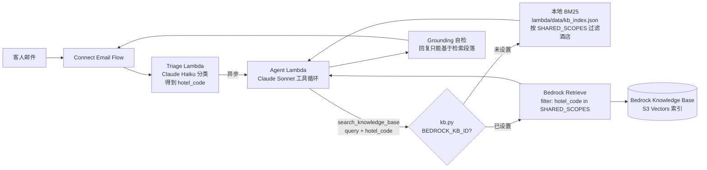
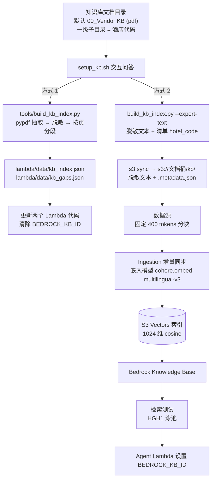

# 知识库配置（`setup_kb.sh`）

知识库给邮件 AI 提供酒店信息、示例会员俱乐部条款与 FAQ、邮件模板等内容（Focus 1，以及其他场景里的政策问答）。`setup_kb.sh` 是独立的中文交互式脚本，负责把知识库文档（默认目录 `00_Vendor KB (pdf)`）整理成 AI 可检索的知识库，并更新已部署的 Lambda。

## 两种方式

| | 1) 本地索引（默认） | 2) Amazon Bedrock Knowledge Base |
|---|---|---|
| 检索 | Lambda 内 BM25 关键词检索（英文分词 + 中文二元组，繁简通用） | 向量语义检索（S3 Vectors），Retrieve API |
| 用到 Bedrock Knowledge Base | 否 | 是 |
| 额外 AWS 资源 | 无（索引随 Lambda 打包） | S3 文档桶、S3 Vectors 向量桶与索引、IAM 角色、Knowledge Base、数据源 |
| 费用 | 无 | 嵌入调用（一次性，约 90 份文本）+ S3 Vectors 存储与查询，少量 |
| 图片型 PDF（18 份菜单、Spa 等） | 无法检索，列入 `kb_gaps.json` | 同样不入库（只上传脱敏文本），列入 `kb_gaps.json` |
| 上传到 AWS 的内容 | 无（索引随 Lambda 打包，已脱敏） | 脱敏后的 `.txt` + `.txt.metadata.json`，原始 PDF 不上传 |
| 按酒店过滤 | `hotel_code` 字段 | 文档元数据 `hotel_code`（`.metadata.json`） |
| 文档更新后 | 重跑脚本，Lambda 代码更新 | 重跑脚本，S3 同步 + 增量 Ingestion |

当前仓库已带一份由 `00_Vendor KB (pdf)` 生成、已脱敏的本地索引：564 个段落，18 份 PDF 无文本。PoC 默认使用这份索引，没有使用 Bedrock Knowledge Base。

## 架构

### 运行时（两种方式共用的调用链）



酒店过滤范围（`lambda/kb.py` 的 `SHARED_SCOPES`）：
- 每家酒店都可以检索自己的文档 + `GENERAL` + `BOOKING`；
- PEN1 与 PEN2 互相可检索（Seaview Resort 的客人可以使用海滩酒店的儿童设施）；
- `LOYALTY` 检索示例会员俱乐部文档 + `GENERAL`。

### 构建（`setup_kb.sh`）



## 使用

```bash
cd PoC
./setup_kb.sh
```

交互问题：

| 步骤 | 问题 | 默认 |
|---|---|---|
| 1/4 | 知识库文档目录（相对 PoC 上一级目录或绝对路径） | `00_Vendor KB (pdf)` |
| 1/4 | 出现未知的一级子目录时，询问其代码 | `GENERAL` |
| 2/4 | 检索方式 1 / 2 | 1（本地索引） |
| 3/4 | Connect 实例 ARN：用于确定区域、账号和要更新的 Lambda；本地方式可留空 | 环境变量 `CONNECT_INSTANCE_ARN` |
| 方式 2 | KB 名称 / 文档桶 / 向量桶 / 索引名 | `sl-email-ai-kb` / `sl-email-ai-kb-<账号>-<区域>` / `sl-email-ai-kb-vectors-<账号>` / `sl-email-ai-kb-index` |
| 方式 2 | 嵌入模型 | 1) `cohere.embed-multilingual-v3`（中英繁）；2) `amazon.titan-embed-text-v2:0` |
| 方式 2 | 确认汇总后开始 | 是 |

本地方式如果本机 python 没有 pypdf，脚本会询问后把 `pypdf==5.1.0` 装到虚拟环境 `~/.cache/email-ai-kbenv`。

### 非交互（CI）

```bash
KB_MODE=bedrock KB_DOC_DIR="00_Vendor KB (pdf)" CONNECT_INSTANCE_ARN=arn:aws:connect:... ASSUME_YES=true ./setup_kb.sh </dev/null
```

| 变量 | 说明 |
|---|---|
| `KB_DOC_DIR` | 文档目录 |
| `KB_MODE` | `local` \| `bedrock` |
| `KB_NAME` / `KB_BUCKET` / `KB_VECTOR_BUCKET` / `KB_INDEX` | Bedrock 资源名 |
| `KB_EMBED_MODEL` | `cohere.embed-multilingual-v3` \| `amazon.titan-embed-text-v2:0` |
| `ANONYMIZE_MAP` | 脱敏规则文件，默认 `../anonymize_map.json` |
| `KB_FOLDER_MAP` | 额外子目录映射，如 `Example Hotel Kuala Lumpur=SLKL` |
| `KB_VENV` | pypdf 虚拟环境路径 |
| `KB_INGEST_TIMEOUT` | 同步等待秒数，默认 1800 |
| `ASSUME_YES` | 非交互时必须为 `true` 才会执行默认“是”的确认（安装 pypdf、开始创建资源） |

## 文档目录约定

- 一级子目录名决定 `hotel_code`：`General Info` → `GENERAL`、`Booking Related` → `BOOKING` 定义在 `tools/build_kb_index.py` 的 `FOLDER_TO_CODE`；各酒店和会员俱乐部子目录的映射（HGH1 / SZX1 / PEN1 / PEN2 / LOYALTY）放在脱敏规则文件 `folders` 中，因为子目录名本身含真实名称。
- 子目录里可以再分层，只认 `.pdf`。
- `Email AI POC Related Flow.pdf`、`General Logic Requirement to AI.pdf` 是流程和规则文档，已写进提示词和代码，不入库（`SKIP_FILES`，以及规则文件的 `skip_files`）。
- 新增酒店：放一个新的一级子目录，脚本会询问代码。另外需要同步补充两处，否则该酒店的检索不会按酒店过滤，查房和签名也找不到：
  - `lambda/kb.py` 的 `SHARED_SCOPES`；
  - `lambda/data/hotels.json`（房价、签名、邮箱映射）。

## 脱敏

- 规则文件 `../anonymize_map.json`（PoC 目录之外，可用 `ANONYMIZE_MAP` 指定）。它包含真实名称，只留在本机，不要随 PoC 分发或提交。
- `tools/anonymize.py` 按规则替换文档正文、分类、文件名和目录名：酒店/品牌/会员计划名、域名、地址、电话（只对知识库和签名生效）、内部系统名等。PDF 文本先做 NFKC 归一化，再替换。
- 两种方式产出的都是脱敏后的内容：本地索引 `kb_index.json`、`kb_gaps.json`，以及 Bedrock 方式上传的文本。
- 找不到规则文件时脚本会警告，确认后才会用未脱敏内容继续。
- 文档里新增了真实名称（比如新酒店）时，先在规则文件里加规则，再重跑脚本。

## 与周部署脚本的关系

- `deploy_week_N.sh` 不构建知识库，只做两件事：
  - 本地方式下，把 `lambda/data/kb_index.json` 打包进 Lambda；
  - Bedrock 方式下，保留 Agent Lambda 上已有的 `BEDROCK_KB_ID`。
- 建议顺序：先 `./setup_kb.sh`，再 `./deploy_week_1.sh`。仓库自带本地索引，不换文档时可以跳过 setup_kb.sh。
- 想在 Lambda 部署前就准备 Bedrock KB：
  1. 运行 setup_kb.sh 方式 2，会提示 KB ID；
  2. 执行 `BEDROCK_KB_ID=<id> ./deploy_week_1.sh`，或者部署后再运行一次 setup_kb.sh。
- 切换方式：再运行 `./setup_kb.sh` 选另一种。从 Bedrock 切回本地时，KB 和向量资源保留不删，Lambda 只是不再调用它。

## 重复执行

- 本地方式：同样的文档生成的索引逐字节相同，Lambda 代码哈希不变就不上传。
- Bedrock 方式：
  - 所有资源先查后建，同名多个时报错退出；
  - `s3 sync` 只上传变化的文件，元数据文件使用固定时间戳；
  - Ingestion 只处理新增、修改、删除的文档；
  - `BEDROCK_KB_ID` 没变时不更新 Lambda。
- 创建后不能修改、脚本也不会去改的项：
  - 嵌入模型：与已有 KB 不一致时报错，换 KB 名称；
  - 向量维度：与已有索引不一致时报错，换索引名；
  - 数据源的分块和解析设置：不一致时只给警告。
- `s3 sync --delete`：会让 `s3://文档桶/kb/` 与文档目录保持一致。不要在该前缀下放其他文件。

## 权限

执行者需要的权限：
- `bedrock:CreateKnowledgeBase / GetKnowledgeBase / ListKnowledgeBases / CreateDataSource / GetDataSource / ListDataSources / StartIngestionJob / GetIngestionJob / Retrieve`
- `s3vectors:CreateVectorBucket / GetVectorBucket / CreateIndex / GetIndex`
- `s3:CreateBucket / ListBucket / PutObject / DeleteObject`
- `iam:CreateRole / UpdateAssumeRolePolicy / PutRolePolicy / GetRole / PassRole`（作用于 `sl-email-ai-kb-role`）
- `lambda:GetFunctionConfiguration / UpdateFunctionCode / UpdateFunctionConfiguration`

脚本创建的 KB 服务角色 `sl-email-ai-kb-role`：
- 信任策略与控制台快速创建的一致：仅限 bedrock.amazonaws.com，并限定本账号的 knowledge-base。
- 只授权：
  - 嵌入模型的 `bedrock:InvokeModel`；
  - 文档桶 `kb/` 前缀的读取；
  - 该向量索引的读写。

Agent Lambda 的角色在周脚本里已包含 `bedrock:Retrieve`，不需要额外改动。

## 验证情况

- **本地方式**：已在本机完整执行。
  - 非交互模式重建的索引与仓库现有索引逐字节一致。
  - 交互模式（模拟终端）测试了：错误目录时重新输入、新子目录询问代码并给出警告、错误 ARN 时重新输入、留空 ARN 只生成索引。
- **Bedrock 方式**：已在测试账号实际执行过一次（非交互，默认选项）。结果：
  - 创建了 KB `sl-email-ai-kb`（状态 ACTIVE，存储 S3_VECTORS），以及文档桶、向量桶与索引、IAM 角色、数据源；
  - 文档桶已开启“阻止公开访问”和 AES256 加密；
  - 扫描 110，入库 92，失败 18。失败的 18 份与本地 `kb_gaps.json` 一致，都是无文本的图片型 PDF；
  - 检索测试中，`hotel_code` 元数据过滤生效：7 个中英繁问题的所有结果都在对应酒店的范围内；
  - 第二次执行没有新建资源、没有重新上传文件，同步结果为“新增 0、修改 0、删除 0”。

  与本地索引对比，两种方式的首条结果基本一致。Bedrock 方式更容易召回邮件模板类文档（`BOOKING`，属于允许范围，但不是酒店资料），正式使用前建议用评估邮件集比较两种方式的回答质量。
- **注意**：那次执行早于脱敏改造，桶里是原始 PDF 和旧酒店代码的元数据。脱敏后的上传（`.txt`）还没在 AWS 上跑过；重跑一次方式 2 会用 `s3 sync --delete` 替换为脱敏文本，并重新同步。

另外，用不存在的角色调用 CreateKnowledgeBase 时，服务返回的是 AccessDenied，而不是"角色不存在"。如果遇到 AccessDenied，先检查 `iam:PassRole`、SCP 和权限边界。

## 排查

| 现象 | 处理 |
|---|---|
| 同步失败数 > 0 | 看脚本打印的失败原因 |
| 检索测试 0 条 | 同步是否 COMPLETE；元数据文件名是否为 `<文件名>.txt.metadata.json` |
| AI 回复说“知识库没有该信息” | 用报表 `08_knowledge_gaps.csv` 找缺失主题，补充文档后重跑脚本 |
| 想回到本地索引 | `./setup_kb.sh` 选 1，确认切换 |
